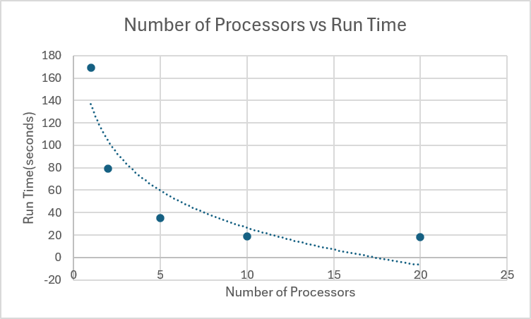

# Lab11_Muliprocessing
CPE2600 Lab 11 Multiprocessing

Implmentation: For this lab I used fork() and excel() so mandel movie could run mandel program once per frame. The parent uses fork() to start one child per frame and each child uses excel() to run the existing mandel program. 

- From the graph, you can clearly see that the relationship between the number of processors and run time is not linear. Sure, the run time difference is vastly noticeable when running 2 processors compared to 1, but after 5 processors the run time starts to flatten out and the speed of the program is less noticeable. 